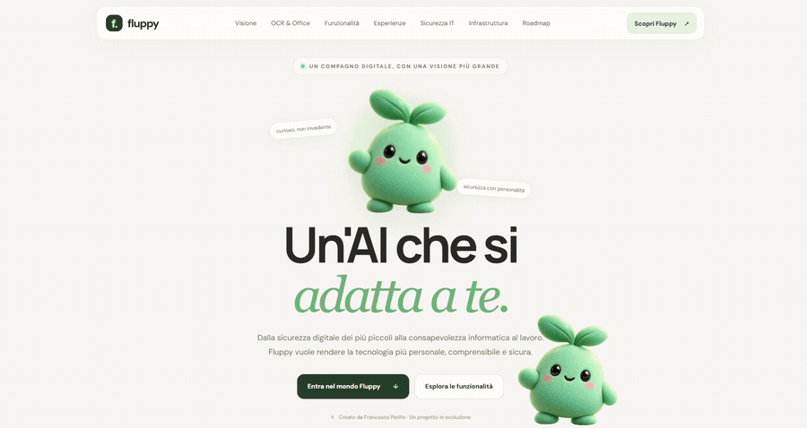
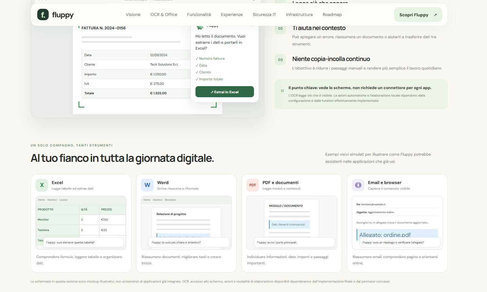

<div align="center">

# FLUPPY 🐾

**L'assistente desktop pensato per rendere la tecnologia più personale, comprensibile e sicura.**




</div>


# La visione

FLUPPY nasce da un'idea semplice: **l'intelligenza artificiale dovrebbe aiutarti, senza costringerti a rinunciare al controllo dei tuoi dati.**

L'obiettivo è sviluppare un assistente desktop capace di affiancarti mentre usi il computer, comprendere il contesto di ciò che visualizzi e aiutarti nelle attività quotidiane, nella produttività e nella sicurezza informatica.

Non un altro servizio che ti obbliga a caricare documenti su una piattaforma esterna: FLUPPY punta a un'esperienza in cui **l'elaborazione avviene direttamente sul tuo dispositivo**, con privacy, controllo e autonomia al centro del progetto.

## L'AI nel tuo computer, non nei tuoi dati online

<div align="center">



*Mockup illustrativo: FLUPPY punta a usare il contesto visibile sul desktop, senza richiedere un'integrazione separata con ogni applicazione.*

</div>

Attraverso tecnologie come l'**OCR** (*Optical Character Recognition*), FLUPPY punta a riconoscere testi e informazioni visibili sullo schermo per fornire spiegazioni, suggerimenti e guide passo dopo passo.

L'obiettivo è assisterti mentre utilizzi Excel, Word, PDF, email e browser, senza dover cambiare continuamente applicazione.

## 🔒 La privacy non è un optional

La visione di FLUPPY privilegia un'architettura **locale, sul dispositivo dell'utente**:

- **I tuoi dati restano tuoi.** Documenti, schermate e informazioni personali sono pensati per essere elaborati localmente.
- **Nessun server AI esterno obbligatorio.** L'obiettivo è evitare di dover inviare i tuoi contenuti a servizi cloud per ottenere assistenza.
- **Più controllo, meno dipendenze.** Un'architettura locale può ridurre l'esposizione dei dati a fornitori terzi e la necessità di connessioni esterne.
- **Privacy by design.** Il trattamento delle informazioni dovrà ridurre al minimo la raccolta e la trasmissione dei dati.

> **Il principio è chiaro: i tuoi dati non dovrebbero lasciare il tuo computer solo per permetterti di usare un assistente AI.**

## Un assistente, contesti diversi

| Area | Obiettivo |
|:--|:--|
| **Family** ♡ | Accompagnare i più piccoli verso un uso consapevole e sicuro della tecnologia. |
| **Home** ⌂ | Semplificare le attività quotidiane e aiutare chi ha meno familiarità con il computer. |
| **Enterprise** ▦ | Supportare il lavoro rispettando policy, permessi e riservatezza dei dati aziendali. |
| **Sicurezza IT** ◈ | Rendere più comprensibili gli avvisi di sicurezza e aiutare le persone a capire come comportarsi. |

## 🛡️ Nato dalla sicurezza informatica

FLUPPY nasce dall'esperienza del prototipo **DOTTY Security** e amplia la sua visione: dalla consapevolezza informatica a un assistente desktop più versatile.

Il progetto esplora possibili integrazioni con Microsoft Defender, Splunk, Microsoft Sentinel e tecnologie SIEM, IDS e IPS. Queste integrazioni richiedono sviluppo specifico e non sono attualmente disponibili nel sito di presentazione.

## 📁 Struttura

```text
.
├── index.html
├── style.css
├── script.js
├── assets/
│   ├── fluppy-demo.gif
│   └── web1.png
└── README.md
```

**La tua AI deve lavorare per te. Non il contrario.**

Ideato e sviluppato da Francesco Petillo 💚

